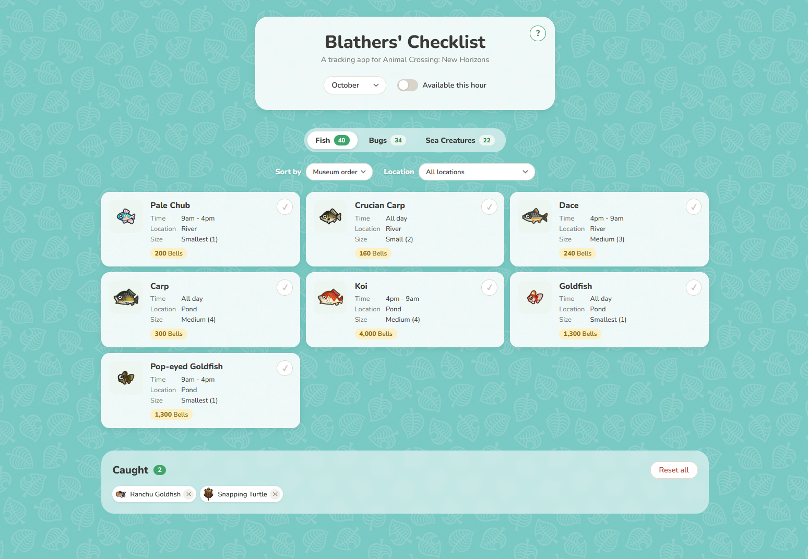

# Blathers' Checklist

A tracker for Animal Crossing: New Horizons that shows which fish, bugs and sea creatures you can catch right now and haven't caught yet, so you know what's still missing from your museum.

## Features

- **See what's around this month.** It opens on the current month, and you can switch to any other month to plan ahead.
- **Available this hour.** Flip the toggle to only show what you can catch right now.
- **Fish, bugs and sea creatures** each get their own tab, with a count of how many are left.
- **Sort and filter.** Sort by name, price or time of day, or filter by location (river, pond, on trees and so on).
- **Mark things as caught.** Hit ✓ and the creature moves to the Caught list at the bottom. Hit ✕ there to undo.
- **Your progress is saved** in your browser, so it's still there next time you visit.

Each card shows when and where to find the creature, its shadow size, and how many Bells it sells for.

## Credits

The creature data and icons come from the community-made ACNH API. This is a fan project and isn't affiliated with Nintendo.
